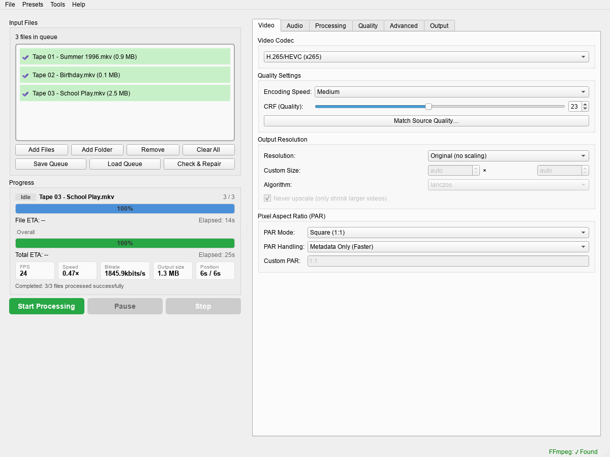
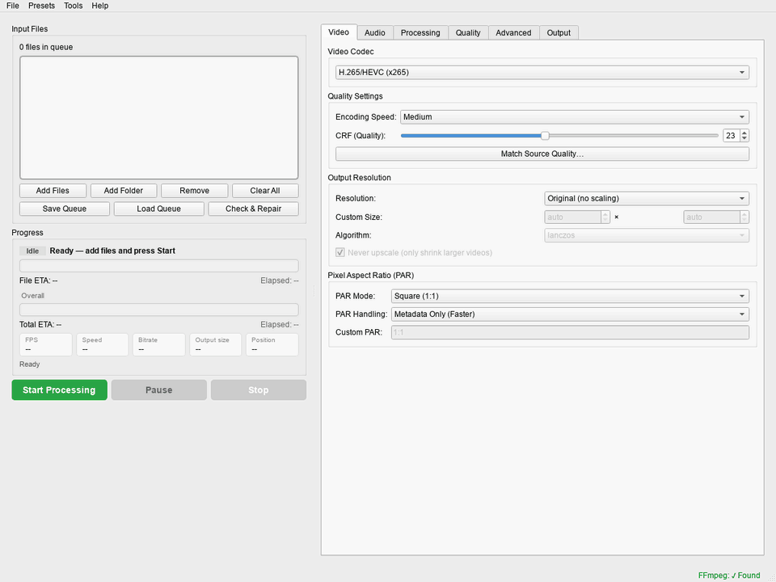

# videer

**Drop videos in, press Start, get them re-encoded — deinterlaced properly and each at the CRF it actually needs.**

videer is a batch GUI for FFmpeg. It deinterlaces with **QTGMC** — the deinterlacer that is still the reference
for analogue tapes and broadcast captures, [see for yourself](https://www.youtube.com/watch?v=jE47A57T5FA) — either
the classic AviSynth+ script or **QTempGaussMC**, vs-jetpack's rewrite of it for VapourSynth, which videer installs
for you with one button. And it **picks the CRF by measuring it, one per file**: *Match Source Quality* encodes
short samples at candidate CRFs, scores them against the original with **VMAF** (or NEG, 4K, MS-SSIM, SSIM, PSNR,
XPSNR — pick the bias you understand), and settles on the highest CRF, the smallest file, that still meets the
quality you asked for. A clean cartoon and a grainy film print never wanted the same number.





## What it does

1. **Queue** files or whole folders (drag and drop works everywhere on the window); duplicates are refused and
   batches sorted naturally.
2. **Optionally measure** each file's own CRF (*Quality* tab) — a few seconds of probe encodes per file.
3. **Deinterlace** if asked: QTempGaussMC (VapourSynth), QTGMC (AviSynth+) or FFmpeg's bwdif / yadif.
4. **Encode** with FFmpeg — x264, x265, VVenC, SVT-AV1, libaom, VP9, NVENC, ProRes — into MKV, MP4, MOV, AVI or
   WebM, keeping audio, subtitles (converted where the container needs it), chapters and tags.
5. **Optionally verify** every finished file against its original with the same metric.

Nothing is downloaded unless you ask: FFmpeg (*Tools ▸ FFmpeg Features*) and VapourSynth (*Tools ▸ VapourSynth*,
or *Install VapourSynth…* on the Processing tab) each say what they fetch, from where, and how big it is first.

## In detail
### Quality matching — a CRF per file, measured

- **Every file gets its own CRF.** Tick *Find each file's own CRF before encoding it* on the Quality tab and
  the queue searches each entry separately: it samples that file, finds the CRF that keeps *its* quality, and
  encodes it at that number. A clean cartoon and a grainy film print do not want the same setting, and a batch
  encoded at one CRF gets one of them wrong — which is the whole problem with batching by a number
- The chosen CRF appears next to the file in the queue, goes into its output filename, and is written to its
  log with the score and target that produced it. A file the search cannot answer for falls back to the CRF
  slider rather than failing
- **Match Source Quality…** (`Ctrl+M`, or the button under the CRF slider) runs the same search on one file
  with every probe shown — CRF, score, estimated size of the finished video stream, and what that is as a
  share of the source — so you can see the trade-off before committing a whole queue to it. Applying a result
  copies the criteria to the Quality tab, so the batch is judged the way that file just was
- **Seven metrics, because no metric is the truth.** VMAF is the default and the one trained on human scores,
  but it was trained for 1080p viewed from three screen-heights away, so it reads high on UHD and can be
  flattered by anything that adds apparent sharpness. **VMAF NEG** removes that gain, **VMAF 4K** re-anchors
  the scale for UHD, **MS-SSIM** and **SSIM** measure structure instead of predicting opinion, and **PSNR**
  and **XPSNR** measure signal error alone. Each carries its own named targets and its own scale — 0-100,
  0-1 or decibels — and the tab explains what each one is biased towards
- **Pooling, which is usually what "the score looked fine but the encode doesn't" means.** A mean is what
  everyone quotes and is exactly what hides a bad scene: twenty smeared seconds inside ten good minutes barely
  move it. Pool on the harmonic mean, the 5th or 1st percentile, or the single worst frame, and the search
  steers by how bad it gets instead of how good it usually is
- Targets are named rather than numeric — *visually lossless*, *transparent*, *high*, *good* — or any value you
  type. Sample count and length are yours to set, as is the CRF window to search, which defaults to the range
  that suits the selected encoder because AV1's CRF scale is not x265's
- It says when re-encoding is not worth it: a target no CRF in the range could reach means a grainy or already
  heavily compressed source, and an estimate no smaller than the original means stream copy is the better choice
- **Verification** scores every finished encode against its original with the same metric and pooling, and
  shows the result next to the file
- Uses the encoder, speed preset and filters currently selected, so the answer is for the encode you are about
  to run. VMAF, its variants and MS-SSIM need an FFmpeg built with `libvmaf`; SSIM, PSNR and XPSNR are in every
  build, and metrics this build cannot compute are greyed out rather than hidden

### Repair

- **Check & Repair** (`Ctrl+R`, or the button under the queue) decodes every file in the queue from end to
  end, counts what FFmpeg complains about, and shows the batch as a table — which recordings are damaged,
  how badly, and what can be done about each. *Check only* writes nothing at all
- Damage comes in two kinds and they want opposite treatments. **Rebuilding the container** fixes a broken
  index, wrong timestamps or a file that was cut off mid-write, and costs nothing: every compressed frame is
  copied through untouched, so the result is the same video, only playable and seekable again.
  **Re-encoding** is the only thing that helps when the picture data itself is damaged — the decoder conceals
  what it cannot decode and a clean stream is written, at the price of a re-encode
- **Automatic** does the honest thing: rebuild the container, measure again, and spend the re-encode only if
  the error count says it must. Every file is decoded again after treatment, so the table reports the fix as
  measured — *113 errors → 0* — rather than asserting it worked. A repair that changed nothing says so
- Repaired files are written as `<name>.repaired.<ext>` beside the original, which is never touched unless
  *Replace the original* is ticked — and even then only for files that actually improved, with the original
  kept as `<name>.old<ext>`. A repair that lands in a different container than the source keeps its own
  extension rather than becoming Matroska wearing an `.mp4`
- For a file that was cut off, it reports what survived: *7s, where the damaged file claimed 12s*
- It also names what it cannot do: an MP4 whose index (`moov` atom) was never written cannot be opened by
  FFmpeg at all, and no option changes that — the report says so, and points at untrunc and a reference file
  from the same device instead of failing quietly

### Queue

- Add files, add folders (recursive), or drag & drop files/folders onto the list; batches are sorted naturally
  (`Tape 1, Tape 2, Tape 10` — not `1, 10, 2`)
- **Duplicate detection**: a file already in the queue is skipped, even if it is added again under a different spelling
  (relative/absolute path, different letter case, symlink) or appears twice in the same drop. Skipped files are
  reported in the status line.
- **Live queue**: add or remove files while encoding is running — pending entries are appended/removed without
  restarting; files already processed or in progress cannot be removed
- Drag entries to reorder; each entry is coloured by state (▶ running, ✔ done, ✖ failed) and shows its VMAF score
  when enabled
- **Save Queue / Load Queue** (`Ctrl+S` / `Ctrl+L`): write the queue — file order, per-file state and a snapshot of
  the current encoding settings — to a `.json` file, and load it back later to replace or extend the queue. On load
  you choose whether to skip the files already marked done and whether to apply the settings stored with the queue;
  files that have moved or been deleted are reported and skipped.
- **The queue survives a restart**: it is autosaved to `queue.json` next to the application on every change and after
  every file, and restored on the next start with the already-encoded files left out — a crash or a power cut costs
  at most the file that was in flight
- **Pause / Resume** the whole run (suspends FFmpeg and its children, ETAs are corrected for the pause) and **Stop**

### Encoding

- Video: H.264 (x264), H.265/HEVC (x265), H.266/VVC (VVenC), AV1 (SVT-AV1 or the libaom reference encoder), VP9,
  NVIDIA NVENC H.264/HEVC/AV1 (`p1`–`p7` presets), ProRes, raw, or stream copy; CRF quality on each encoder's own
  scale and per-encoder speed presets
- NVENC quality options (Advanced tab): rate-control lookahead, spatial + temporal adaptive quantisation with
  strength, quarter- or full-resolution multi-pass, B-frame count and B-frames-as-reference. All on by default —
  FFmpeg ships them off — and each can be turned back off when throughput matters more than quality
- Audio: AAC, MP3, Opus, AC3, FLAC, PCM, or stream copy; bitrate control and optional stereo downmix
- Containers: MKV (the only one that carries `pgssub`), MP4, AVI, MOV, WebM
- Deinterlacer choice: `QTempGaussMC` (VapourSynth, any OS — installed from inside the app), `QTGMC` (AviSynth+,
  Windows) or FFmpeg's `bwdif` / `yadif` (any OS, any input); field order and optional frame-rate halving. Picking
  QTGMC switches AviSynth+ and the ffms2 source filter on automatically; picking QTempGaussMC switches AviSynth+ off,
  since one encode goes through one frameserver
- Optional resolution scaling (2160p → 360p presets or custom W×H, "never upscale" guard, lanczos / bicubic / spline /
  bilinear / neighbor scaler)
- PAR / DAR presets and custom values, with metadata-only or resampling handling
- AviSynth+ pipeline with `SetFilterMTMode` multithreading, ffms2 source filter, optional raw pre-transcode for
  problematic inputs, and a free-form script box; every plugin QTGMC needs across *all* its presets is bundled in
  `plugins/` (masktools2, mvtools2, nnedi3, RgTools, ffms2, yadifmod2 for *Ultra Fast*, FFT3DFilter + FFTW for *Very Slow*)
- CUDA GPU acceleration support; 64-bit implementation
- Extra FFmpeg arguments pass-through; save / load your own presets, plus bundled Web / High Quality / Archive / AV1 /
  VVC presets; `defaults.json` support for your own startup defaults

### File handling

- Output is written next to the source as `<name>_<vcodec>_<acodec>[_crf<N>][_abr<N>][_<res>].<ext>`; timestamps
  are copied from the original. Only the settings that actually applied are named — a stream copy has no CRF and
  FLAC has no bitrate
- **Replace Original Files**: the encode takes over the original filename; the original is kept as `<name>.old<ext>`.
  The encode always carries its own container's extension, never the source's — `tape.avi` becomes `tape.mkv`
  with the original at `tape.avi.old.avi`, `TAPE.MKV` comes back as `TAPE.mkv` — because a `.avi` file holding
  Matroska lies about what it is
- **Delete Source Files After Processing**: permanently deletes each source right after *its* encode succeeds — one by
  one as the queue progresses, so disk space is freed while long batches are still running. The source is only removed
  when the output exists and is non-empty; files that fail or are stopped keep their source. Combined with *Replace
  Original Files* the `.old` backup is removed too. There is no recycle bin and no undo — the start dialog warns you
  when this is on.
- Per-file `<name>.log` with the full FFmpeg command line and output; temporary `.avs` / `.vpy` / `.ffindex` /
  `.trans.avi` files are cleaned up

### Feedback

- Live progress panel: per-file and total ETA, fps, speed, bitrate, output size, position — parsed from FFmpeg's
  machine-readable `-progress` output
- Settings sanity check before starting (container/codec mismatches, ignored options, missing AviSynth plugins,
  VapourSynth not ready for QTempGaussMC, destructive options)
- Opt-in quality score for every finished encode, in any of seven metrics, and a metric-driven CRF search
  before it — per file, across the whole queue; see *Quality matching* above
- Cross-platform: runs on Windows, Linux and macOS (AviSynth+/QTGMC are Windows-only; QTempGaussMC runs on all
  three); no shell or PowerShell calls

## Output

```
Tapes/
├── Tape 01.avi                                  ← the source, untouched (unless you ask for replacing)
├── Tape 01_libx265_aac_crf23_abr256.mkv         ← the encode, named after what was used
└── Tape 01.log                                  ← FFmpeg's command line and output, per file
```

Every encode carries its full settings in its own tags (`description`: one line of JSON; `comment`: a readable
summary), so a file can be reproduced from itself years later.

## Install

**Installer** — from the [latest release](https://github.com/hclivess/videer/releases/latest):

| OS | File | Notes |
|---|---|---|
| Windows x64 | `videer-<version>-windows-x64-setup.exe` | Installs for your user only — no administrator rights — with a Start-menu entry and an uninstaller |
| Linux x64 | `videer-<version>-linux-x64.deb` | `sudo apt install ./videer-*.deb` — Debian, Ubuntu 22.04+ and derivatives; adds `videer` to the menu and the PATH |
| macOS (Apple silicon) | `videer-<version>-macos-arm64.dmg` | Open it and drag *videer* to *Applications* |

**Portable** — the same release carries `.zip` (Windows) / `.tar.gz` (Linux, macOS) archives: unpack anywhere and
run `videer`. A portable copy keeps everything it writes (presets, the queue, a downloaded FFmpeg or VapourSynth) in
its own folder. So does the Windows installer's copy, which lives in your own `%LOCALAPPDATA%\Programs`; the
`.deb` installs to `/opt`, which is not yours to write to, so there — and wherever videer cannot write beside
itself — it uses your user data folder instead (`~/.local/share/videer`, `~/Library/Application Support/videer`,
`%LOCALAPPDATA%\videer`).

Every file has a `.sha256` beside it.

**From source** — Python 3.12: `pip install -r requirements.txt && python main.py` (or `run.cmd` / `run.sh`).

**External tools**

- **FFmpeg** — on the PATH or beside videer. *Tools ▸ FFmpeg Features* fetches a build with VMAF and every encoder
  videer can drive (Windows, Linux); on macOS `brew install ffmpeg`.
- **VapourSynth**, for QTempGaussMC — *Install VapourSynth…* on the Processing tab. It downloads a private, pinned
  and checksummed Python (about 21–33 MB) and installs VapourSynth, vs-jetpack and the plugins QTempGaussMC uses
  into it from PyPI, about 250 MB in all, inside videer's own folder. Nothing else on the machine changes; *Remove*
  in the same dialog undoes it. Available on Windows x64, Linux x64 / ARM64 (glibc 2.35+, i.e. Ubuntu 22.04 or
  newer) and macOS 15+; VapourSynth publishes nothing for Windows on ARM.
- **AviSynth+**, for QTGMC (Windows only) — [AviSynth+](https://github.com/AviSynth/AviSynthPlus/releases); the MT
  build videer was tested with is attached to the
  [3.7 release](https://github.com/hclivess/videer/releases/tag/3.7) as `AviSynthPlus-MT-r2772.exe`. Every
  AviSynth plugin QTGMC needs is bundled.

## Windows says the app is not safe

The Windows build is not code-signed yet, so SmartScreen calls it unrecognised. That is a statement about a missing
certificate, not about the file:

- **"Windows protected your PC"** → *More info* → *Run anyway*.
- A zip downloaded from the web carries the mark of the web; `Unblock-File .\videer-*.zip` before unpacking clears it.
- Check what you downloaded against the published checksum:
  `Get-FileHash .\videer-<version>-windows-x64-setup.exe -Algorithm SHA256` and compare with the `.sha256` file.
- If Defender flags it, report the false positive at <https://www.microsoft.com/wdsi/filesubmission>.

## Settings

| Tab | What is there |
|---|---|
| **Video** | Encoder (dropdown), speed preset, CRF / CQ / QP on the encoder's own scale, *Match Source Quality…*, resolution scaling, PAR |
| **Audio** | Codec (dropdown), bitrate, stereo downmix |
| **Processing** | Deinterlacing — on/off, deinterlacer, field order, halve the frame rate; the VapourSynth status with *Install VapourSynth…* / *Re-check* while QTempGaussMC is selected · AviSynth+ — on/off, FFMS2 source, your own script lines · raw pre-transcode for problem inputs |
| **Quality** | Metric, target, pooling, sampling, CRF search window, per-file CRF matching, verification |
| **Advanced** | NVENC lookahead, adaptive quantisation, multi-pass, B-frames; DAR; threads; extra FFmpeg arguments |
| **Output** | Container, replace originals, delete sources, damaged-stream tolerance |

Every setting is part of a preset (*Presets* menu: built-ins, your own, *Save Current as Defaults*).

## CLI

```
videer --install-vapoursynth        install VapourSynth for QTempGaussMC without a window; exit code 0 when it runs
```

| Environment variable | Effect |
|---|---|
| `VIDEER_SELFTEST=<file>` | Headless self-test: encode the file, exit 0 only if a real output appeared (CI runs this on the frozen build) |
| `VIDEER_SELFTEST_SETTINGS=<json>` | Settings laid over the self-test's own, e.g. `{"deinterlace": true, "deinterlacer": "qtempgaussmc"}` |
| `VIDEER_NO_STATE=1` | Neither load nor save your settings and queue — for scripted runs |
| `VIDEER_NO_FFMPEG_PROMPT=1` | No startup offer to fetch FFmpeg |
| `VIDEER_VSPIPE=<path>` | Use this `vspipe` for QTempGaussMC instead of looking for one |

## Tips

- **Tapes and DVDs look combed / jagged in motion** → *Processing ▸ Enable Deinterlacing*, QTempGaussMC, and set
  *Top Field First* to match the source (DV is bottom field first, most other capture is top).
- **Motion is smooth but the file is twice as many frames as the source** → that is correct: each field becomes a
  frame (50p from 25i). *Reduce Frame Rate* keeps the source's frame rate instead.
- **QTempGaussMC says VapourSynth cannot run it** → *Install VapourSynth…* (again), or *Re-check* after installing
  it yourself; the status line's tooltip names the `vspipe` in use.
- **The score looked fine but the encode does not** → *Quality ▸ Pooling*: 5th percentile instead of the mean.
- **AviSynth+ errors on MP4 / MKV sources** → *Use FFMS2 Source Filter* (AVISource reads only AVI).
- **A batch of mixed material** → *Quality ▸ Find each file's own CRF*.

## Build

```
pip install -r requirements.txt pyinstaller
python build.py                     # archive + installer for this OS, each with a .sha256
python build.py --no-installer      # archive only
python tools/layout_check.py        # no clipped controls, no widget attribute shadowing a Qt method
python tools/screenshot.py          # retake thumb.png and demo.gif from a real run
```

The Windows installer needs [Inno Setup 6](https://jrsoftware.org/isinfo.php); the `.deb` needs `dpkg-deb`, the
`.dmg` `hdiutil`. CI builds all three on every tag and proves them: the frozen build installs VapourSynth with its
own code on every OS, deinterlaces a generated interlaced clip through QTempGaussMC on Linux, and the `.deb` is
installed and run.

## Changes in 3.17

**QTempGaussMC, the rewrite of QTGMC** ([#18](https://github.com/hclivess/videer/issues/18))

- **A second QTGMC, and the one to use where it runs.** QTempGaussMC is vs-jetpack's reimplementation of QTGMC for
  VapourSynth: the same algorithm, researched stage by stage, with the bit-depth scaling errors of every legacy
  version fixed and — by its authors' measurements — two to three times the speed at equal settings. It is a new
  entry in the deinterlacer list beside QTGMC (AviSynth+), bwdif and yadif. Its defaults are its tuned
  configuration — the rewrite retired the preset system — so videer's speed preset goes to the encoder alone;
  *Reduce Frame Rate* becomes its frame-rate divisor.
- **Installed from inside the app, on every OS.** *Install VapourSynth…* fetches a pinned, checksummed standalone
  Python into videer's folder and installs VapourSynth and exactly the plugins QTempGaussMC calls into it — no
  registry, no system Python, no `~/.config` entry; on Linux and macOS even VapourSynth's own configuration file
  stays inside that folder. A status line on the Processing tab says whether it is ready, and the settings check
  says so before a queue starts if it is not. `videer --install-vapoursynth` does the same without a window.
- **Served by `vspipe`, not by FFmpeg's VapourSynth reader.** FFmpeg finds VapourSynth on Windows only through a
  registry entry, and most Linux builds have no VapourSynth reader at all; a `vspipe` pipe works with every FFmpeg.
  A pipe carries only the picture, so audio, subtitles, chapters and tags are taken from the source file itself —
  and a source whose picture starts after its sound keeps that offset.
- **The two processes are one step.** *Stop* kills both, *Pause* suspends both, and a script that dies halfway
  fails the file: FFmpeg would otherwise see an ordinary end of stream and finish a truncated encode with exit
  code 0, under the final name.
- Behind it, AviSynth+ and VapourSynth now sit behind one frameserver interface (`modules/frameservers/`); the
  command builder and the process runner no longer know which one they are talking to. The AviSynth+ scripts
  videer writes are byte-for-byte what 3.16 wrote.

**Installers for every OS**

- **Windows `setup.exe`, Linux `.deb`, macOS `.dmg`** beside the portable archives, built and checked by CI. The
  Windows installer needs no administrator rights; uninstalling removes the FFmpeg and VapourSynth videer
  downloaded but keeps your presets.
- **An installed copy writes to your user data folder** when it cannot write beside itself (`/opt` from the `.deb`,
  a translocated macOS app): presets, `defaults.json`, the queue autosave and the downloaded tools. A portable
  copy stays self-contained as before.
- The Windows executable carries a version resource and is built without UPX, every download has a `.sha256`, and
  the build signs the executable and installer when a certificate is configured.

**Interface**

- The video and audio codec lists are **dropdowns** instead of two long columns of radio buttons.

**Fixed**

- **An FFmpeg put beside a packaged videer was never found** — the lookup derived "beside the executable" from the
  location of its own code, which in a packaged build is the bundle's `_internal` folder.
- **AviSynth+ ignored the raw pre-transcode** and read the original file; it now reads the intermediate it was
  given, and that intermediate's FFMS2 index is cleaned up too.
- The self-test picked up the user's saved settings and queue, and wrote its own queue over the saved one; it now
  runs on the stock settings and leaves nothing behind (`VIDEER_NO_STATE` does the same for scripted runs), and a
  run that cannot start fails at once instead of at the ten-minute timeout. It also asked for the speed preset
  `ultrafast`, which matched nothing in the list, and so tested *Medium*.
- `-hwaccel cuda` is no longer added in front of an AviSynth script, which hands FFmpeg decoded frames.

Presets, `defaults.json` and saved settings from 3.16 work unchanged.

## Changes in 3.16.3

- **Every encode is tagged with the full settings it was made with.** The old builds wrote the codec,
  preset, CRF and audio settings into the file's `description` tag, and that went missing in a rewrite;
  the file only said *Made with videer*. It is back, and complete: the `description` tag now holds the
  whole configuration the file was encoded with, as one line of JSON — every setting on every tab, with
  the CRF the file actually got when *Match Source Quality* ran — so an encode can be reproduced, or its
  settings rebuilt into a preset, from the file alone. The `comment` tag stays readable: the videer
  version, the project URL, and a one-line summary — the encoder and its quality number (`CRF 23`,
  `CQ 30`, `QP 32`), the speed preset as the encoder saw it, the audio codec and bitrate, and whatever
  else changed the picture (scaling, deinterlacing, PAR/DAR, extra FFmpeg options). AVI has no
  description field, so there both go into the comment. `ffprobe`, MediaInfo, mpv and most players show
  them.
- **File sizes are logged.** Each finished file reports its size before and after in the log and the
  per-file log — `205.5 KB -> 54.9 KB (27% of the original, 150.5 KB saved)` — and the batch reports its
  total at the end. Measured before any replacement, while both files are still under their own names.
- The stock settings claimed a 16:9 display aspect ratio with the mode on *Auto*; the UI always overrode it,
  but anything building a command straight from the defaults got `-aspect 16:9`. Now `auto` like the mode.

## Changes in 3.16.2

- **A replaced file always wears its container's extension.** *Replace Original Files* built a fresh name only
  when the output container differed from the source's; when they matched it reused the original filename
  as it was, so the extension came from the file being replaced rather than from the encode — `TAPE.MKV`
  re-encoded to MKV stayed `TAPE.MKV`. The destination is now always the original's stem plus the encode's
  own extension, lower-cased, whatever the source was called: `tape.avi` becomes `tape.mkv`, `TAPE.MKV`
  becomes `TAPE.mkv`, and a batch of mixed containers all come out under the one chosen. The backup keeps
  the original's extension (`tape.avi.old.avi`), and the repair tool follows the same rule.

## Changes in 3.16.1

- **The quality number is named for the encoder, and carried across when the encoder changes.** The slider
  said *CRF* whatever was selected — on VVenC the number is a QP, on NVENC a CQ — and it kept its value
  through a change of encoder, which is the wrong value: x265's CRF 23 is not VVenC's QP 23 (nearer 28), nor
  SVT-AV1's CRF 23 (nearer 30). The label now follows the encoder — *CRF*, *CQ* or *QP* — on the Video tab,
  the Quality tab, in the search window, the log and the queue, and switching encoders converts the number to
  its rough equivalent on the new scale, using the pairings FFmpeg's own guides and the encoders' defaults
  suggest: x264 23 ≈ x265 28 ≈ SVT-AV1 / libaom 35 ≈ VP9 34 ≈ VVenC 32, with NVENC's CQ tracking the software
  encoder of the same codec. Rough is the word — it keeps the *meaning* of the number through a change of
  encoder, and *Match Source Quality* is still how to get the right one. Output filenames name the knob too:
  `_cq30` for NVENC and `_qp32` for VVC, `_crf23` as before for the rest.

## Changes in 3.16

**Two more generations of codec**

- **H.266/VVC**, through Fraunhofer's VVenC (`libvvenc`). VVC is HEVC's successor and, in the standard's own
  tests, needs around 40 % fewer bits than HEVC for the same quality — paid for in encoding time and, for now,
  in players: FFmpeg 7 and anything built on it (mpv, for one) decodes it, browsers and most hardware do not
  yet. VVenC has no CRF; its constant-quality knob is a QP on a 0–63 scale, and that is what the quality
  slider and the *Match Source Quality* search set for it (the search defaults to 20–44). It takes 10-bit
  input only, so it is fed `yuv420p10le`; its five presets are spread over videer's nine speeds. VVC goes into
  MKV, MP4 or MOV — AVI has no tag for it and writes a file nothing can play, WebM refuses it — and the settings
  check says so before a queue starts.
- **AV1 by two more encoders**, alongside SVT-AV1: `libaom-av1`, the AOMedia reference encoder — the slowest
  and the most thorough, run with `-row-mt` so it uses the cores it has — and `av1_nvenc` for the RTX 40
  series and newer, which gets the same lookahead / adaptive-quantisation / multi-pass / B-frame options as
  the other NVENC encoders. Both are searchable by *Match Source Quality*, and both are allowed in WebM.
- **The quality slider knows the encoder's scale**: 0–51 for x264, x265 and NVENC H.264/HEVC, 0–63 for the AV1
  encoders, VP9 and VVC. Switching encoder moves the ceiling, and a value above it is clamped instead of being
  refused by the encoder later.
- **An encoder this FFmpeg was built without is named before the encode starts**, not by a failed job: the
  settings check warns, and *Tools ▸ FFmpeg Features* lists VVC and AV1 encoding among what the build cannot do
  and offers the one that can. The BtbN builds videer fetches carry VVenC, libaom and SVT-AV1; the FFmpeg 6.1
  that distributions still package has never heard of VVenC.
- A bundled *Next Generation (H.266 VVC/Opus)* preset, next to the AV1 one.

## Changes in 3.15

Everything since 3.13, in one place: the quality search was taking measurements that did not mean what they
said, subtitled sources could not be encoded at all, and the window that shows the search was unreadable.

**Quality matching, made to measure the encoder**

- **The search scored the deinterlacer, not the encoder.** Probes were encoded with the filter chain the real
  encode uses; the source they were compared against was not filtered at all. Deinterlacing in the default
  `send_field` mode gives the encode two frames for every one of the source's, so the metric lined up
  interpolated fields against whole frames half a frame away in time and read **VMAF 65 for an encode worth
  99**. No CRF can climb out of that, so the search walked to the bottom of its range and reported the target
  as never reached — in exactly the deinterlacing configuration videer exists for. The chain is now applied to
  both sides. On one 1080i source at CRF 20: 65.6 before, 98.7 after; with the frame rate halved as well,
  72.4 before, 99.9 after.
- **A target set for one metric was used with another.** VMAF counts to 100, SSIM to 1.0, XPSNR in decibels.
  On an FFmpeg without `libvmaf` — the ordinary Windows *essentials* build has none — videer quietly measured
  with SSIM and kept the 95 that had been set for VMAF, a score SSIM cannot reach. Every probe read *below
  target*, every file got the bottom of the range. A number outside a metric's own scale is now refused
  outright, in the search, in the Quality tab and in loaded presets, and a search that has to substitute a
  metric says so.
- **A target nothing can reach no longer ends in a CRF recommendation.** The lowest CRF tried is the *largest*
  file the range allows; recommending it for a target it does not meet, to someone who came to save space, is
  worse than saying nothing. It now recommends nothing, names what the source actually managed and at which
  CRF, and suggests aiming there or below. *Apply* is disabled, and the batch matcher keeps the queue's own
  CRF and says so per file.
- **And it finds that out in two probes instead of five**: the first CRF to miss the target is followed
  straight by the bottom of the range, which is the best quality on offer. If that misses too, nothing between
  them can succeed.
- **videer now fetches an FFmpeg that can measure VMAF.** VMAF is not part of a plain FFmpeg build — it has to
  be compiled in. *Tools ▸ FFmpeg Features* lists what the FFmpeg in use cannot do and offers to download a
  build that can: the URL, the size and the destination are on screen first. It fetches from BtbN/FFmpeg-Builds
  (Windows and Linux, x64 and ARM64), keeps only `ffmpeg` and `ffprobe`, checks that what arrived runs and
  really has `libvmaf`, and selects VMAF once it does. macOS is pointed at `brew install ffmpeg`. The fetched
  copy lives in `ffmpeg/bin` beside videer and wins over the PATH one, because the PATH one is usually the
  reason for the download; delete the folder to undo it.

**Encoding**

- **A subtitle track could take the whole file down with it.** Encoding a subtitled MP4 to MKV failed before a
  single frame was written: the source's subtitles are `mov_text`, MKV was told to copy them, and Matroska is
  the one container that cannot hold `mov_text` — `Subtitle codec 94213 is not supported`. Every file in a
  queue of MP4s went the same way. Each subtitle stream is now decided on its own: copied where the container
  accepts it, converted where it wants another text format (`mov_text` to SRT for MKV, SRT/ASS to `mov_text`
  for MP4 and MOV), and left out only when it is a picture no conversion can place, which is said out loud.
- **And if that judgement is wrong, the file still survives.** A muxer that rejects the subtitles gets the
  encode again with them converted, and if that is refused too, once more without them. The refusal happens
  while writing the header, so each retry costs about a second, and a file rescued by one is not reported as
  a file that failed.
- **A failed encode says why it failed.** FFmpeg puts the cause on one line ("Opus mapping family undefined
  for 12 channels") and the failure on the next, and the error scan matched only *error*, *invalid* and
  *failed* — keeping the line that says nothing. It now knows the vocabulary FFmpeg uses, and any run that
  exits non-zero prints its last twelve lines of output under the errors.

**Interface**

- **Wrapped text was drawn on top of the controls around it.** A word-wrapped `QLabel` reports one line's
  worth of height however much text it holds, and the layout believes it — so the metric note in *Match Source
  Quality* sat across the two combo boxes beside it and none of the three could be read. Every explanatory
  label in the app now reports the height its text actually needs.
- **The Match Source Quality window flooded the console with errors**, because it kept its state in attributes
  named `metric` and `result` — both names Qt uses on every dialog, for painting and for the `exec()` return
  code.
- The startup offer to fetch a better FFmpeg is skipped under `VIDEER_SELFTEST` and `VIDEER_NO_FFMPEG_PROMPT`:
  a modal question with nobody at the keyboard is a hang, and it cost two releases their Linux binaries.

**Earlier in this line** — a pass over code the newer features had made it obvious nobody had looked at twice:
multi-row queue drags that reordered the list but not the queue; *Replace Original Files* moving Matroska onto
a `.avi` name; AviSynth+ failing outright on a video with no audio track; *Reset to Factory Defaults* leaving
extra FFmpeg arguments and custom PAR/DAR behind; presets filed inside a packaged bundle instead of beside the
application; settings written non-atomically; and output filenames naming a CRF for a stream copy.


## Changes in 3.13

- **Check & Repair for damaged files** (`Ctrl+R`). Decodes every file in the queue, counts the errors, and
  repairs what can be repaired: rebuilding the container where the damage is a broken index, bad timestamps
  or a recording that was cut off mid-write — lossless, every frame copied through — and re-encoding past
  the damage where it is the picture data itself that is broken. *Automatic* tries the free fix first and
  only spends the re-encode when the error count says it has to. Every file is decoded again afterwards, so
  the result is measured rather than assumed, and a repair that achieved nothing says so. Repaired files are
  written beside the originals, which are only replaced if asked — and never with a file in a different
  container wearing their extension.

- **A CRF per file, not per queue.** *Find each file's own CRF before encoding it* (Quality tab) runs the
  quality search on every entry in the queue and encodes each one at the number that file needs. Batching by a
  single CRF was always the wrong shape for the problem — a clean cartoon and a grainy film print do not want
  the same setting, and one of them was always getting it wrong. The chosen CRF shows next to the file, goes
  into its output filename, and is written to its log along with the score and target that produced it. A file
  the search cannot answer for falls back to the CRF slider instead of failing.
- **Seven metrics to choose from.** Plain VMAF was reading generously, and it has good reason to: it was
  trained for 1080p viewed from three screen-heights away, so it scores high on UHD, and it rewards anything
  that adds apparent sharpness. There is now a choice — **VMAF**, **VMAF NEG** (the enhancement gain removed),
  **VMAF 4K** (re-anchored for UHD), **MS-SSIM**, **SSIM**, **PSNR** and **XPSNR** — each with its own named
  targets, its own scale, and a line in the UI saying what it is biased towards. It is not a small difference:
  on the same grainy test source, VMAF asked for CRF 29 and XPSNR asked for CRF 20.
- **Pooling, which is the other half of why a search can read high.** The mean is what everyone quotes and is
  exactly what hides a bad scene — twenty smeared seconds inside ten good minutes barely move it. Frames can
  now be pooled by mean, harmonic mean, 5th or 1st percentile, or the single worst frame, so the search can
  steer by how bad it gets rather than how good it usually is. Every metric is read frame by frame from the
  filter's own log for this.
- The post-encode score follows the same metric and pooling, so verification and matching finally answer the
  same question, and the queue shows the result under the metric's own name instead of always saying "VMAF".
- New **Quality** tab collects all of it: metric, target, pooling, sampling, CRF search window, automatic
  matching and verification. The old *Calculate VMAF Score After Encoding* checkbox moved there from Output;
  presets and `defaults.json` written by earlier versions still switch it on.


## Changes in 3.12

- **Match Source Quality** (`Ctrl+M`, or the button under the CRF slider) finds the CRF this particular source
  actually needs, instead of leaving you to guess one. It encodes a few short samples of the real file at
  candidate CRF values, scores each against the original with VMAF, and bisects to the **highest** CRF that
  still meets the quality you asked for — highest, because among the settings that keep the quality, the
  largest CRF is the smallest file. A 20-step range costs about five probes of a few seconds of video each.
- Targets are named rather than numeric: *visually lossless* (VMAF 97), *transparent* (95, the default),
  *high* (93), *good* (90), or any value you type. Sample count and length and the CRF range to search are
  yours to set; the range is remembered per encoder, because AV1's CRF scale is not x265's.
- Every probe is reported as it finishes — CRF, score, estimated size of the finished video stream, and what
  that is as a share of the source — so what you are choosing between is visible, not just the answer.
- It says when re-encoding is not worth doing: a target no CRF in the range could reach means a grainy or
  already heavily compressed source, and an estimate no smaller than the original means stream copy is the
  better choice.
- The search uses the encoder, speed preset and filters currently selected, and is unavailable while the
  queue is running — probe encodes competing with the queue for the CPU would measure neither honestly.
- Needs an FFmpeg built with `libvmaf`; builds without it (Ubuntu's stock package, among others) fall back to
  SSIM and say so in the dialog.
- The post-encode VMAF score no longer decodes the audio track: without `-an` FFmpeg was selecting an audio
  stream and encoding it into the null muxer for the whole length of the comparison.


## Changes in 3.11

- **The Windows taskbar shows the app's own icon.** The taskbar button takes its icon from the process's
  Application User Model ID rather than from the window, and with none of its own the process was grouped
  under whatever launched it and wore that program's icon. One is now set before any window exists, and it
  carries no version number so a pinned button survives an upgrade.
- **A real icon.** The app shipped a single 48×48 image; there is now a drawn icon at 16, 20, 24, 32, 40,
  48, 64, 128 and 256 pixels, so every size Windows asks for is there rather than scaled from one.
- The icon file is found beside the frozen executable, inside a one-file bundle or in the source tree,
  instead of only where deriving the path from `__file__` happened to look, and the main window is given it
  as well as the application.


## Changes in 3.10

- **The queue survives a restart.** It is autosaved next to the application on every change and after every file,
  and restored on the next start with the already-encoded files left out — a crash or a power cut now costs at most
  the file that was in flight. **Save Queue / Load Queue** (`Ctrl+S` / `Ctrl+L`) write the same format to a file you
  keep: file order, per-file state and a snapshot of the encoding settings.
- **Drag and drop works again during a run** — and everywhere on the window. The file list never implemented
  `dragMoveEvent`, so the inherited handler asked the *list model* whether it could accept `text/uri-list`; it can't,
  the platform cancelled the drag mid-flight and no drop ever arrived. Starting a run then set `NoDragDrop`, which
  switches drops off at the viewport, and the `setAcceptDrops(True)` after it only covered half of that (`DropOnly`
  is what that code wanted). The main window had `setAcceptDrops(True)` and no handlers at all, so every drop that
  missed the list rectangle was discarded.
- **NVENC is no longer driven with its quality features switched off.** FFmpeg's defaults are `-rc-lookahead 0`,
  `-spatial-aq false`, `-temporal-aq false` and `-multipass disabled`, so the old `-preset pN -tune hq -rc vbr -cq N`
  command encoded with no lookahead, no adaptive quantisation and a single pass — most of NVENC's reputation for
  soft, detail-smeared output. Lookahead, spatial + temporal AQ, full-resolution multi-pass and B-frames-as-reference
  are now on by default, each a toggle in **Advanced ▸ NVIDIA NVENC Quality** since they all cost encoding speed.
  B-frames as reference needs Turing (RTX 20xx / GTX 16xx) or newer.

## Changes in 3.9

A run that finished could leave FFmpeg processes behind that videer could no longer see or stop — the queue reported
"done" while every core stayed busy. This release closes that off and the paths around it.

- **A finished queue means no encoders left running.** If anything went wrong while reading FFmpeg's output, the child
  was dropped from process tracking *without being killed* — invisible to both Stop and the quit-time cleanup, and one
  more was started for the next file. Teardown now kills before it forgets.
- **Wedged FFmpeg processes are noticed and stopped.** Stop was only checked when a line of output happened to arrive,
  and the wait for exit had no timeout, so a process that stopped producing output held the queue and the CPU forever.
  There is now a stall watchdog (30 min of complete silence) and a 60 s deadline on exit after output closes.
- **Stop no longer lies.** It waited 5 s, called `QThread.terminate()` — which returns before the thread has actually
  stopped, and can land mid-bytecode holding the GIL — and then reported "stopped" while FFmpeg ran on. The run now
  ends when the worker actually unwinds, and a new run cannot start on top of one still shutting down.
- **A failing file can no longer wedge the app.** An error outside the per-file handler (read-only directory, locked
  log, over-long Windows path) killed the worker silently, leaving the UI locked in "processing" forever — and the
  close prompt asking about a thread that was long dead. Completion is now signalled on every exit path.
- **Error output is bounded.** Every matching line was kept in memory and written to an unrotated log: roughly 3.7 GB
  of RAM and 6.5 GB of disk per hour on a damaged source. Logs now rotate (15 MB per file at most) and error text is
  capped at the first and last 200 lines with the rest counted.
- **Editing the queue during a run is safe again.** The splice point came from a queued GUI slot, so any open dialog
  froze it and already-encoded files could be pushed back into the pending tail and encoded a second time.
- Raw intermediates and AviSynth scripts are written next to the source instead of the process working directory,
  where a raw AVI (~100 GB per hour of 1080p) landed in the install folder and same-named sources collided.
- QTGMC no longer oversubscribes the CPU: `Prefetch(N)` with `EdiThreads(E)` asked for N×E workers, so 16 cores meant
  64. The budget is now divided rather than spent twice.
- Pause identifies the process it suspends by handle rather than PID, so it cannot suspend an unrelated process that
  inherited the PID; `libc` is resolved before forking; per-file loggers no longer leak.

## Changes in 3.8.1

- **Quitting kills everything we started**: every FFmpeg/ffprobe process goes through `utils/childproc.py` — killed on
  normal quit, on Stop (including its children), and by the kernel if videer dies for any reason (Windows Job object,
  Linux `PR_SET_PDEATHSIG`).
- Duplicate queue entries are rejected: adding a file or folder that is already queued (same normalised absolute path)
  is skipped and reported.
- Natural sort everywhere files are collected or listed (`img2 < img10`, `Episode 9 < Episode 10`), via the shared
  `utils/naturalsort.py`.

## Changes in 3.8

- **Never a partial file**: FFmpeg now writes to `<name>.part.<ext>` and the file is renamed to its final name only
  when the encode completed and is non-empty. Stop or a failed encode removes the `.part` file.
- Packaging switched to PyInstaller; CI runs a real encode on the frozen Linux build (`VIDEER_SELFTEST`).
